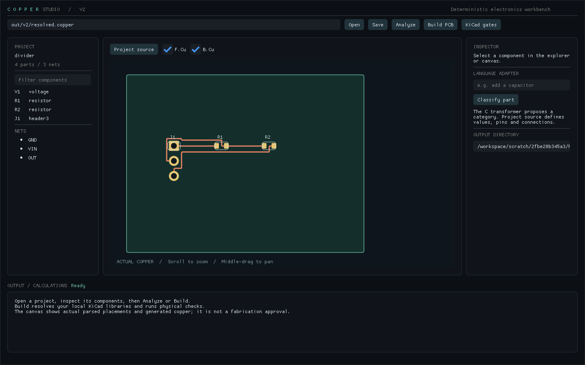

# Copper Studio V2

A local electronics compiler and GLFW/Vulkan workbench built on your original C kernel.
English proposes a component category. A typed S-expression project owns parts, pins,
connections, requirements and process rules. Deterministic solvers and native KiCad
checks decide whether the result meets the implemented constraints.

**Start with [START_HERE.txt](START_HERE.txt).** The executable examples are in
`examples/v2`. A complete generated divider project and its native validation reports
are in `examples/generated/divider`.



## Build

Core: C17 compiler or newer, CMake 3.20+, Python 3.10+ for the adapters.
Desktop: C++17 compiler, Vulkan SDK/loader and GLFW 3.3+. Dear ImGui 1.91.9b is vendored.

```sh
cmake -S . -B build -DCMAKE_BUILD_TYPE=Release
cmake --build build --config Release --parallel
ctest --test-dir build -C Release --output-on-failure
python tools/copper.py check examples/v2/divider.copper
python tools/copper.py build examples/v2/divider.copper --out out/divider
python tools/copper.py verify --out out/divider
```

Use `python3` on Linux if `python` is unavailable. Set `COPPER_CORE` if the executable
is in a nonstandard build directory. On Windows, `copper.cmd` builds the core and runs
the same commands. `hwc project ...` is also available alongside the legacy CLI.

```sh
cmake -S . -B build-desktop -DCOPPER_BUILD_DESKTOP=ON
cmake --build build-desktop --config Release --parallel
# Linux: build-desktop/desktop/copper-studio
# Visual Studio: build-desktop\desktop\Release\copper-studio.exe
```

If GLFW is not discoverable, set `glfw3_DIR` to its installed CMake package directory
or pass the vcpkg CMake toolchain when configuring. No dependencies are fetched during
CMake configuration. Keep the source directory with the built desktop application;
this is a source distribution, not a relocatable installer.

## Connected features

- General editable `.copper` projects, up to 256 components/nets and 64 pins per part.
- Local custom part catalogues; installed KiCad symbols/footprints as the default geometry source.
- Inherited symbol resolution; explicit pin-to-pad matching; selected library snapshots in exports.
- DC MNA: resistors, ideal voltage/current sources, Shockley diodes, capacitor open circuits,
  inductor shorts, and explicit connector boundaries. Unsupported active devices block analysis.
- Reference transistor models: first-order Ebers-Moll NPN/PNP and Level-1 NMOS/PMOS (no charge
  storage; see [NONLINEAR_MODELS.md](docs/engineering/NONLINEAR_MODELS.md)), with explicit models
  and pin maps; never a claim of manufacturer-model fidelity.
- Fixed-step transients (Backward Euler or trapezoidal) with transactional state commits and
  explicit failure reports, from zero initial stored energy; see [TRANSIENT.md](docs/engineering/TRANSIENT.md).
- Explicit current/power calculations, KCL/residual validation, rating derating and voltage targets.
- Exhaustive corners for up to eight uncertain resistors; nonlinear corner results are sampled
  extremes, not proof of every interior operating point.
- Two-layer Manhattan A* candidate routing, with original `u128` exact copper predicates as checks.
- Circle, axis-aligned rectangle, rounded-rectangle and oval pads at 90-degree rotations.
- Width, clearance, opens/shorts, annular rings, holes, edges, drill aspect ratio, soldermask web,
  assembly-envelope gaps, and conservative DC trace resistance/drop/current-density budgets.
- `.kicad_sch`, `.kicad_pcb`, `.kicad_pro`, `.kicad_dru`, BOM, calculation report, board SVG and hashes.
- Native KiCad 9 ERC, DRC, schematic parity and independent pin/net comparison.
- A tiny trained transformer implemented in C, with local weights, retraining script, rejection
  of unknown vocabulary and mixed roles. Its output is a proposal, never an engineering decision.
- A real Vulkan desktop app: source editor, project explorer, selectable board canvas,
  pan/zoom, layer toggles, inspector, background analysis/build, and native KiCad checks.

## Commands

`pcba` is the primary command (built with the core; `pcba.cmd` builds and runs it on Windows).
See [docs/engineering/CLI.md](docs/engineering/CLI.md) for the full command map, exit codes
and JSON output.

```sh
pcba design "Build me an ESP32 LED PCB. Generate the KiCad PCB." --out out/esp32_led --profile profiles/esp32_led.design
pcba --help
pcba doctor
pcba project check examples/v2/divider.copper
pcba project build examples/v2/divider.copper --out out/divider
pcba project verify --out out/divider        # KiCad 9.x ERC/DRC/parity; PASS only if everything ran
pcba simulate transient examples/v2/rc.copper --dt 1e-4 --steps 100 --out out/rc.csv
pcba spec parse "a 5 V supply on VIN, a 10k resistor from VIN to OUT, a 20k resistor from OUT to GND" --out d.espec
pcba spec lower d.espec --out d.copper      # only a complete spec (no errors, no open questions)
```

`pcba spec` is the V2 requirements frontend: constrained English or a hand-written `.espec`
file becomes an EngineeringSpec with units and provenance, missing decisions become
clarification questions, and a complete spec is handed to the compiler as a `.copper`
project. See [ENGINEERING_SPEC.md](docs/engineering/ENGINEERING_SPEC.md).

Parts are data, not code: `pcba parts import FILE [--into my.parts]` checks a catalogue against copper-core
and the installed KiCad 9.x libraries (symbol pins = footprint pads, pin maps, MCU pins). MCU modules such as
`profiles/mcu_modules.parts` (ESP32-WROOM-32E) carry a typed *behavioral boundary*: supply range, GPIO
directions, thresholds, current limits, strapping, reset and programming pins, checked in DC. Firmware and
silicon are not simulated. See [PART_REGISTRY.md](docs/engineering/PART_REGISTRY.md) and
`examples/v2/esp32_io.copper`.

`pcba design "REQUEST" --out DIR` compiles a request end to end: it lists every decision with its source
(request, answers, design profile, catalogue or design rule), asks when a decision is open, builds the KiCad
project and reports 11 quality gates. See [DESIGN.md](docs/engineering/DESIGN.md).

`pcba place FILE --out placed.copper` searches placements deterministically (constructive placement, seeded
annealing, rip-up/reroute, current-driven trace widening) and writes the best candidate only if copper-core
finds no hard violation; otherwise it reports why no feasible board exists. `pcba route FILE --out DIR` routes a
given placement with the same exact re-check. See [LAYOUT.md](docs/engineering/LAYOUT.md) and the measured
[LAYOUT_BENCHMARK.md](docs/engineering/LAYOUT_BENCHMARK.md).

The commands below are the underlying `tools/copper.py` backend, kept for compatibility:

```sh
python tools/copper.py new divider --out my_board.copper --vin 5 --r 10000 --r2 20000
python tools/copper.py new rc --out filter.copper --r 1000 --c 0.000001
python tools/copper.py transient filter.copper --dt 0.00001 --steps 1000 --out out/transient.csv
python tools/copper.py classify "add a capacitor"
python tools/copper.py catalogue --search resistor
python tools/copper.py part-add --file custom.parts --id precision_r --kind R --symbol Device:R --footprint Resistor_SMD:R_0603_1608Metric --power 0.1 --voltage 50 --tolerance 0.01
# Values above illustrate the schema; verify ratings for the actual part you purchase.
python tools/hwc_kicad.py catalog --out out/installed_symbols.json --csv out/installed_symbols.csv
python tools/hwc_kicad.py custom-symbol --help
```

`--catalogue custom.parts` and `--rules profiles/conservative.rules` are accepted by
`new`. A custom catalogue is overlaid on `profiles/default.parts`: a part with the same id
replaces the bundled one, so you only list what you change. A hand-written project can use
any defined ID. Device models, pin maps and rating provenance are described in
[DEVICE_MODEL_CONTRACT.md](docs/engineering/DEVICE_MODEL_CONTRACT.md).
After changing a catalogue, update/re-create the embedded project part definition:
projects deliberately snapshot their parts rather than silently changing underneath you.

`build --draft` permits an explicit failed draft when an active model is unavailable.
It does not mark physics as passed. `build --no-route` exports placement with unresolved
connections reported as failures. The `fabricate` command requires fresh native checks,
unchanged hashes, and zero internal findings before asking KiCad to export CAM files.

Acceptance: `python tools/prompt_acceptance.py --pcba build/pcba.exe [--native --kicad-cli PATH] [--esp32]` runs the
English corpus and the English → KiCad path with honest outcomes; see
[M0_ACCEPTANCE_EVIDENCE.md](docs/engineering/M0_ACCEPTANCE_EVIDENCE.md).

The audit checklist results (profile, per-rule DFM table, triage) are in
[AUDIT_CHECKLIST.md](docs/engineering/AUDIT_CHECKLIST.md) and [DFM_RULES.md](docs/engineering/DFM_RULES.md).

Release readiness, the capability matrix by stage and all open issues are in
[RELEASE_READINESS.md](docs/engineering/RELEASE_READINESS.md).

The numerical baseline (dense MNA, Newton, AC, transient, corners) is measured against closed-form oracles
by `numeric_bench` and `python tools/numeric_bench.py`; findings and the ranked improvement plan are in
[NUMERICAL_ROADMAP.md](docs/engineering/NUMERICAL_ROADMAP.md).

## Verification and scope

See [VALIDATION.md](docs/v2/VALIDATION.md) for exact test evidence and environment.
The generated divider was checked with **KiCad 9.0.9: zero ERC/DRC violations, zero
unconnected items, and matching schematic/board/electrical-IR connectivity**.
Unknown generic-part ratings and heights are still reported (seven warnings in the
supplied example); `fabricate` blocks until these are supplied and all checks pass.

This is a working, bounded V2, not a finished replacement for KiCad or a general circuit
synthesis system. Complex IC model libraries, multi-unit symbols, arbitrary rotated
pads, zones/planes, complex board outlines, general SPICE analysis (AC covers only the built-in models), thermal fields,
SI/EMC, assembly stencil analysis and industrial-scale autorouting remain out of scope.
The desktop currently edits project source, not graphical wires or footprints.

Your original code and tests remain in the project. `u128.c/.h` and `copper.c/.h` retain
identical contents to the input ZIP. The old CLI is retained for compatibility; its
legacy schematic path is narrower than `hwc project ...`.

Architecture and file format: [ARCHITECTURE.md](docs/v2/ARCHITECTURE.md).
Model details: [MODEL_CARD.md](models/MODEL_CARD.md).
