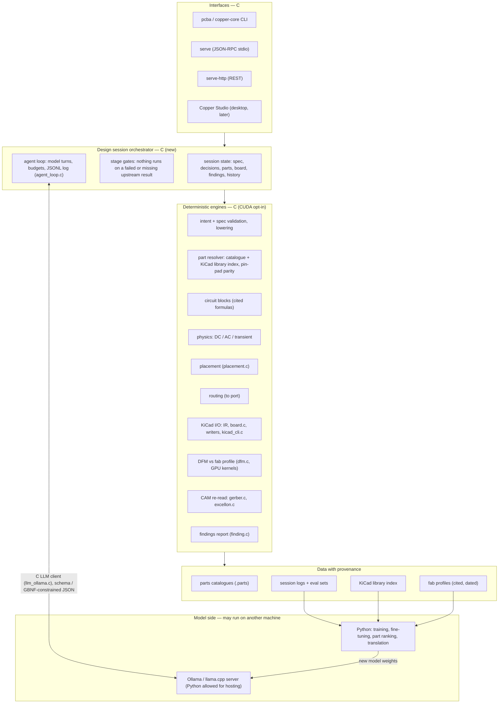
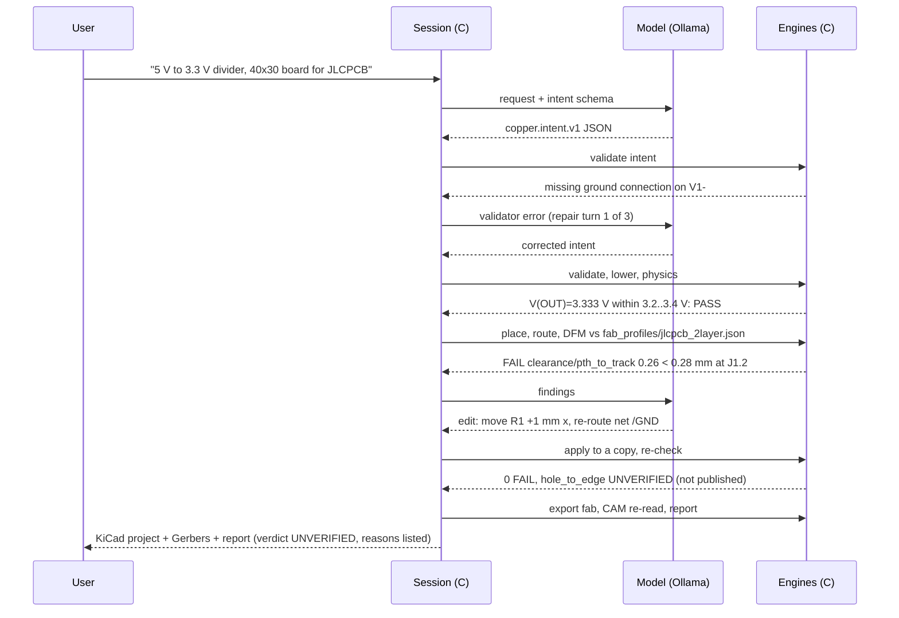

# Copper: target architecture, audit, and plan for a smart system

*Written 2026-11-07 against branch `v2/complete`, for a developer joining the project.*

**The goal:** a request in English ends as a board a fabricator can make, with the evidence to show it.

**The owner's rules** apply throughout (`CLAUDE.md`):
- physics, placement and everything deterministic run in C; the CLI is C;
- Python is used only for language models, learning and hosting a model.

**The principle,** carried over from the owner's October plan: **the model proposes; the C engines decide.**

This document has four parts:
1. where the project stands today, stage by stage;
2. the architecture it should grow into;
3. how the LLM and the C engines work together, and how the system scales;
4. a step-by-step plan, with the tools that can be used and the checks a developer should run first.

---

## 1. Where we stand

### 1.1 One-paragraph summary

**What works, from a request to a KiCad project, for small circuits:**
- resistor dividers and RC/RL filters;
- an ESP32 module with an indicator LED;
- the I2C, USB-C sink, LDO and reset/boot blocks.

The request is read by a constrained-English grammar, not an LLM. The physics checks and the placement run in C. Routing, KiCad export and the orchestration are still legacy Python.

**What has been added as C modules, but not yet connected to `pcba design`:**
- the new board model, DFM against cited fab profiles, the Gerber and Excellon readers and the safe kicad-cli runner (tracks A–E);
- the tool and REST servers and the LLM agent (tracks F–G, REST).

**No board from `pcba design` can be called manufacturing-ready yet.** Native KiCad 9 checks have not run on this machine. The DFM in the design pipeline is the legacy one. And the example divider **fails** JLCPCB's published plated-pad-to-track limit: two tracks are 0.26 mm from J1.2, against a minimum of 0.28 mm. The router works to Copper's own rule profile, not the fabricator's.

### 1.2 Audit: English → board → manufacturing-ready

**Legend.**
- **Language:** **C** = done in C; **Py-legacy** = deterministic Python to port (rule in `CHARTER.md` §3.1); **Py-ok** = Python that is allowed (language and learning).
- **Verified:** ✅ tested here; ⚠️ tested only partly or with a development tool; ❌ not built.

| # | Stage | What exists | Language | Verified | Gap for "manufacturing-ready" |
|---|---|---|---|---|---|
| 0 | Entry (CLI) | `pcba` (about 30 commands), `copper-core` (physics, board, dfm, gerber, report, serve, serve-http, place, agent-eval) | C | ✅ `pcba_cli`, `hwc_cli_integration` | most `pcba` commands call `tools/copper.py`; the C modules are reached through `copper-core` only |
| 1 | Understand the request | `tools/spec_nlp.py`: a constrained-English grammar (units, Unicode, contradictions); `Extras/tokenizer.c` + `src/v2/transformer.c`: a 10-category intent classifier in C (inference only) | Py-ok + C | ✅ `engineering_spec`, prompt corpus 34 PASS, 1 skipped | only phrasings the grammar knows; **no LLM in the design path** |
| 2 | Engineering spec (IR) | `.espec` EngineeringSpec, validation and lowering to `.copper` (`tools/spec_ir.py`) | Py-legacy | ✅ `test_spec` | port step 8 |
| 3 | Decisions and questions | `tools/design.py`: every decision has a source; open decisions become questions; contradictions are INVALID_INPUT | Py-legacy | ✅ `design_compiler` | port step 9 |
| 4 | Parts | `.parts` catalogues with provenance, `part_registry.c`, `kicad_generic_provider.c` (C); the KiCad library index, SQLite FTS5 (`tools/kicad_library.py`) | C + Py-legacy | ✅ `parts_registry`, `kicad_library` | MPNs only from catalogues (no procurement data); index not in C (port step 5) |
| 5 | Circuit blocks | 6 blocks with cited formulas (`tools/blocks.py`) | Py-legacy | ✅ `circuit_blocks` | port step 7 |
| 6 | Physics | MNA DC, AC, transient; diode/BJT/MOSFET; junction limiting; condition estimate; current bounds | **C** | ✅ `mna*`, `transient`, `numeric_oracles` | thermal, signal integrity and EMC out of scope |
| 7 | Placement | `src/v2_src/placement.c` (exact nm, multi-seed annealing, median-pull, refinement); used by `layout.optimize` | **C** | ✅ `placement`, `test_layout.CPlacer` | does not use fab-profile limits; 2-sided placement not supported |
| 8 | Routing | `tools/layout.py`: grid A*, 45°, rip-up, current-based widths, clearance margin | Py-legacy | ✅ `layout_optimizer` | **port step 2**; 2 layers; clearance from Copper rules, not the fab profile (this is the JLC FAIL above) |
| 9 | KiCad export | `tools/copper.py` (+ `kicad_pcb.c`, `kicad_schematic.c` in C) and the library snapshot | Py-legacy + C | ✅ export tests; ⚠️ native only with KiCad 10 | port steps 3–4; zones and multi-unit symbols not supported |
| 10 | Native KiCad checks | ERC, DRC and parity through `copper.py native_gates`; C runner `kicad_cli.c` (new) | Py-legacy + C | ⚠️ KiCad 9 not on this machine: 5 tests UNVERIFIED | wire `kicad_cli.c` into the pipeline; run on KiCad 9 |
| 11 | DFM | legacy `dfm_pcb.c` (double mm, `profiles/*.rules`) **in the pipeline**; V2 `dfm.c` + `fab_profiles/jlcpcb_2layer.json` (cited) **not in the pipeline** | C | ✅ V2: oracle-equal on 6 KiCad 9 boards | switch the pipeline to V2 DFM; zone fills not modelled |
| 12 | Fab outputs and re-read | `fabricate` exports through kicad-cli and re-reads drill files (`excellon.c`); new: `gerber.c`, the hole comparison in the tool server | C + Py-legacy | ✅ readers on real KiCad 9.0.6 files | Gerber images not yet compared in `fabricate`; no pick-and-place (BOM/CPL) check |
| 13 | One report | `design.json` gates (Python); new: `finding.c` one sorted report | Py-legacy + C | ✅ golden report | make `design.json` gates produce Findings |
| 14 | Smart layer | `tool_server.c` (JSON-RPC), `rest_server.c`, `llm_*.c`, `agent_loop.c`, eval | **C** (client) | ✅ with the mock; ⚠️ live model not run here | tools cover **checking**, not **designing**; no intent schema; no repair loop |
| 15 | GPU | `dfm_kernel.h`, `dfm_cpu_ref.c`, `cuda/dfm_gpu.cu` | C / CUDA | ⚠️ CPU verified; GPU not run here | run on the owner's RTX 4050 |
| 16 | Learning | `tools/train_intent.py` (the tiny classifier only) | Py-ok | ✅ | no dataset pipeline, no part-ranking or translation model |

### 1.3 Scorecard

| Question | Answer today |
|---|---|
| Can English become a KiCad project? | **Yes**, for the supported circuit families and phrasings |
| Is every deterministic step in C? | **No.** Physics, placement, the board model, DFM, CAM readers, the runner, servers and the LLM client are C. Spec lowering, decisions, blocks, routing, export and orchestration are still Python. |
| Is the result manufacturing-ready? | **No.** Native KiCad 9 is unverified here, the V2 DFM is not in the pipeline, the router ignores fab limits, and MPNs and ratings come only from hand-made catalogues. |
| Is an LLM in the loop? | **Only for checking tools.** The agent can load, check and export a board; it cannot yet propose or repair a design. |
| Can it be trusted? | Every result is PASS, FAIL, UNVERIFIED, NOT_IMPLEMENTED or INVALID_INPUT, with sources. Nothing is guessed. The test suite is 76/76: 11 skipped by default, or 7 with `KICAD_CLI` and `KICAD_DEMOS_DIR` set (re-measured 2026-11-08). |

---

## 2. The target architecture



**Five rules hold the architecture together.**

1. **One session, one source of truth.** A C orchestrator owns the design state: spec, decisions, parts, board and findings. The CLI, JSON-RPC, REST and the agent are views of it. Today that state is spread across `design.py` files on disk.
2. **The model only proposes.** Every model output is a JSON object that matches a schema; the GBNF or Ollama `format` makes this so. A C validator decides whether it is accepted. The model never writes files, runs KiCad, picks a PASS, or invents an MPN, a rating or a fabricator capability.
3. **The engines only decide.** Physics, placement, routing, DFM and CAM are deterministic: the same input gives the same output on any machine, and each result names its sources.
4. **Every step leaves evidence.** Each stage emits Findings, and the session log records the model, its version, the prompt version, raw replies and validator verdicts. A run can be replayed with the mock backend.
5. **Python stays on the learning side.** It trains and serves models from data the C side exports: session logs, the library index, fab profiles. It never sits on the path that produces a board.

---

## 3. How the LLM and the C engines work together

### 3.1 The six interaction patterns

| # | Pattern | The model does | The C engines do | Accepted when |
|---|---|---|---|---|
| P1 | **Intent** | turns the English into `copper.intent.v1` JSON: components, terminals, nets, connections, requirements, board, questions | strict schema check, then a semantic check: dangling terminals, missing source or ground, unit and range errors, invented IDs. Errors go back to the model (bounded repair turns). | the validator passes, **and** the grammar parser agrees where both apply |
| P2 | **Clarify** | phrases the open questions; maps the user's answers to `KEY=VALUE` | finds what is undecided (the `design.py` decision table, ported) | every decision has a source: request, answer, profile, catalogue or rule |
| P3 | **Choose parts** | ranks the candidates the index returns, with reasons | finds the candidates (pin set, footprint, catalogue ratings); verifies the pick (pin-pad parity, ratings against physics stress) | the pick verifies; otherwise the next candidate, or a question |
| P4 | **Repair** | reads the findings (rule, location, limit, measured value) and proposes **typed edits**: move part, rotate, widen trace, change value, re-route net | applies the edits to a copy and re-runs every affected gate | strictly fewer FAILs **and** no new FAIL (monotone), within a turn and time budget |
| P5 | **Explain** | summarises the report for the user, citing finding IDs only | supplies the findings and sources | every claim maps to a finding |
| P6 | **Use tools** | calls tools through the tool server | runs them: today the checking tools; next, `spec.validate`, `design.compile`, `physics.solve`, `place`, `route`, `report` | the tool's own result |



### 3.2 Guardrails, most of them already built

- **Schema-constrained replies.** Done: `agent_reply_schema()`, the GBNF from `schema_gbnf.c`, Ollama `format`.
- **Budgets.** Done: a turn limit of 12 (`AGENT_MAX_TURNS`) and timeouts (`llm_ollama.c`, `kicad_cli.c`). To add: a per-session wall-clock budget and a cap on repair attempts per finding.
- **No tool can overwrite or delete.** Done: the kicad-cli runner refuses existing outputs, and the tool server refuses unknown arguments.
- **Every run is replayable.** Done: JSONL turn and session logs. To add: the model digest and the prompt-template version in each log line.
- **The mock is the default.** Done: tests never need a model.

### 3.3 Scaling

| Dimension | Now | Next | Later |
|---|---|---|---|
| Board size | 3–10 parts, 2 layers | 50–200 parts: BVH everywhere, C router with a spatial index | 4 layers, zones, differential pairs |
| Speed | C engines; BVH clearance; CPU reference 2.7 s at 16k tracks (one thread) | GPU clearance on the owner's RTX 4050; parallel candidates (`COPPER_JOBS`) | GPU cost maps for routing; a batch DRC service |
| Serving | REST and JSON-RPC, single-threaded, localhost | a worker pool, a job queue for long exports, auth behind a reverse proxy | multi-user sessions; the model on a separate GPU box (`--url`) |
| Model | `qwen3:8b` through Ollama (owner's machine), not yet evaluated here | eval set of 50–100 prompts incl. negatives; pick the model by score | LoRA fine-tune on accepted sessions; small task-specific models (intent, part ranking) |
| Data | hand-made catalogues, one cited fab profile | more fab profiles (each cited and dated); C library index | procurement provider with provenance (stock, lifecycle), never invented |

---

## 4. What we can use

### 4.1 Already in this repository (reuse; do not rebuild)

| Need | Use |
|---|---|
| exact geometry, BVH | `src/v2_src/g2_types.c` |
| KiCad files | `IR.c` (lossless S-expressions), `board.c`, `kicad_pcb.c`, `kicad_schematic.c`, `copper_project.c` |
| KiCad CLI | `kicad_cli.c` |
| fab outputs | `gerber.c`, `excellon.c` |
| DFM | `dfm.c` + `fab_profiles/`, and `dfm_kernel.h` for GPU |
| physics | `mna.c`, `mna_ac.c`, `transient.c`, `device_models.c` |
| placement | `placement.c` |
| reports | `finding.c`, `json.c` (reader + writer) |
| serving | `tool_server.c`, `rest_server.c` |
| LLM | `llm_ollama.c`, `llm_mock.c`, `schema_gbnf.c`, `agent_loop.c`, `eval/prompts.jsonl` |
| language (allowed Python) | `tools/spec_nlp.py` (a precise grammar; the LLM's cross-check), `tools/train_intent.py` |
| tests and oracles | `manufacturing_audit/` (real KiCad 9.0.6 CAM), the KiCad demo-board tests, the brute-force DFM oracle |

### 4.2 On the owner's machine (from the October plan; not verified here)

| Item | Use it for |
|---|---|
| Ollama with `qwen3:8b` (Q4_K_M, ~5.2 GB), `phi4`, `llama3.2` | run `scripts/run_llm_eval.ps1 -Backend ollama -Model qwen3:8b`; compare the models |
| NVIDIA RTX 4050 Laptop (6 GB), CUDA 12.3 | build with `-DCOPPER_CUDA=ON`; `dfm_gpu_compare` must PASS |
| KiCad 9.0.6 (it produced `manufacturing_audit/`) | run the 5 native tests that skip here |

### 4.3 Outside tools worth evaluating

Each needs a decision on licence and process boundary before use.

| Tool | Licence | What it would give | How to integrate | Caution |
|---|---|---|---|---|
| llama.cpp `llama-server` | MIT | grammar-constrained decoding with our GBNF | a second backend in `llm_ollama.c` style (HTTP) | keep it out of process |
| SQLite amalgamation | public domain | the KiCad library index in C (port step 5) | vendor one `.c` file into `copper_v2` | the only new C dependency; pin the version |
| ngspice | BSD-style | an independent oracle for the C physics (as `numeric_oracles` uses analytics today) | run as an external process in tests only | a test oracle, not the engine |
| FreeRouting | GPL-3 (Java) | a stronger autorouter for comparison | Specctra DSN/SES over a process boundary, optional | GPL and Java; never link it; Copper's C router stays the default |
| KiKit | MIT (Python) | panelization | external, optional step after `fabricate` | deterministic Python; only as an external tool, not in our path |
| Fabricator and part data (JLCPCB/LCSC pages, distributor APIs) | terms of each service | stock, MPNs, ratings | a provider that records source and date | never invent; respect each service's terms |

---

## 5. The plan

Each step is a branch. Each is done only when its checks pass, and its result is stated as PASS or UNVERIFIED with reasons.

| Step | Work | Main files | Done when | Size |
|---|---|---|---|---|
| **0. Verify on the owner's machine** | KiCad 9 native tests; live Ollama eval (`qwen3:8b`, `phi4`, `llama3.2`); CUDA build and `dfm_gpu_compare`; record versions | none (run only) | the 7 skipped tests run, with results recorded in `V2_STATUS.md` | S |
| **1. Make the pipeline fab-aware** | `pcba design` / `fabricate` use V2 `dfm.c` with a `--fab` profile; the router and placer take clearances from the fab profile; `fabricate` uses `kicad_cli.c`, re-reads Gerbers (`gerber.c`) and holes; `design.json` gates become Findings | `tools/copper.py` (wiring only), `layout.py` (limits in), `placement.c` (limits in), `finding.c` | the divider and the ESP32 LED board PASS JLCPCB DFM, with CAM re-read PASS and one report | M |
| **2. Port the router to C** | port step 2: grid A*, 45°, rip-up, widths, margins, on `board.c` geometry with the BVH | `src/v2_src/router.c` | `test_layout` passes against C; the Python router is retired | L |
| **3. Port export and footprints to C** | port steps 3–4: footprint geometry, resolved copper, schematic and PCB writers | `footprint.c`, `kicad_write.c` | KiCad 9 opens every export; byte-stable output | L |
| **4. A design session in C** | the orchestrator: state, stage gates, history; tools `spec.validate`, `design.compile`, `physics.solve`, `place`, `route`, `report` in the tool server | `session.c`, `tool_server.c` | the full English → fab run through `copper-core serve` alone | M |
| **5. Intent with the model (P1, P2)** | the `copper.intent.v1` schema and its C validator; the repair loop; the grammar parser as a cross-check | `intent.c`, `agent_loop.c` | eval of 50+ prompts (incl. the October plan's negatives) scored per model; unsafe outputs 0 | M |
| **6. Parts with the model (P3)** | the C library index (SQLite); a candidate API; model ranking; C verification | `library_index.c` | every chosen part verified; no MPN without a source | M |
| **7. Repair with the model (P4)** | typed edit operations; apply to a copy; the monotone acceptance rule | `edits.c` | repair turns reduce FAILs on a benchmark set; never add one | M |
| **8. Learning (Python)** | export datasets from session logs; LoRA for intent; a part-ranking model on C-exported data; promote a model only if the eval improves | `learning/` (Python) | a model beats the base model on the held-out eval | L |
| **9. Scale** | REST worker pool and job queue; auth through a proxy; GPU DRC sweeps; 4-layer support | `rest_server.c`, `cuda/` | load and latency targets met; GPU == CPU | L |

**The order matters.**
- Step 1 makes today's boards honest about manufacturability.
- Steps 2–4 put every deterministic step in C, behind one session.
- Steps 5–7 only then give the model more power, each time behind C validators.
- Step 8 trains on the evidence those steps produce.

### 5.1 First-day checklist for a developer

1. **Read** `CLAUDE.md`, `CHARTER.md` §3.1, `docs/engineering/V2_STATUS.md` and this file.
2. **Build:** `cmake -S . -B build -G Ninja -DCMAKE_BUILD_TYPE=Debug && cmake --build build`. It must build with no warnings (C17, `-Wall -Wextra -Wpedantic`).
3. **Test:** run `ctest --test-dir build -j6`. Expect 76/76, with 7 skipped when KiCad 9, Ollama or CUDA are missing. On Windows with MinGW, keep MinGW's Python off `PATH` while running ctest.
4. **Try the whole path:**
   ```
   pcba design "Build me an ESP32 LED PCB. Generate the KiCad PCB." --out out/esp32 --profile profiles/esp32_led.design
   copper-core report out/esp32/build/design.kicad_pcb fab_profiles/jlcpcb_2layer.json
   copper-core serve-http --root .     # then: curl http://127.0.0.1:8765/v1/tools
   scripts/run_llm_eval.sh             # mock; BACKEND=ollama MODEL=qwen3:8b for a real model
   ```
5. **Check the claims yourself:**
   - `tests/test_dfm_demos.py` (brute-force DFM oracle);
   - `tests/test_board_demos.py` (KiCad drill cross-check);
   - `tests/golden/report.json`;
   - `tests/golden/tool_server/*.jsonl`.
6. **Pick up step 0 or step 1** from the plan above.
